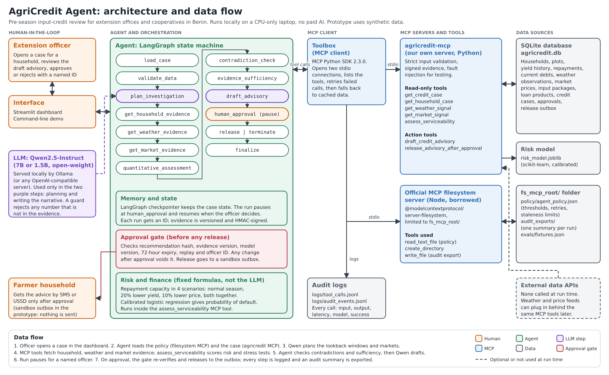

# AgriCredit Agent

**Evidence-first agricultural input and credit risk advisory for local extension offices and cooperatives.**

An evidence-first agricultural underwriting agent that helps extension officers match farming households to input packages and credit offers they can realistically service. It is not an autonomous lender, a replacement for the officer, or a farmer-facing chatbot. It drafts; a named officer decides.

Built new for the Qhala Trust African Agentic AI Design Challenge (Agriculture & Food Security track). Benin-focused, amounts in FCFA. **All household, farm and repayment data is synthetic.**

Challenge theme: **Input & credit risk**: matching a household's yield history and repayment record to an input package or credit offer it can actually service. Office and workflow: a local agricultural extension office or cooperative credit desk, during the pre-season input-credit review.

**Demo video** (one continuous, unedited run, under 3 minutes): https://youtu.be/Xq7xbSzWFhI

## Problem statement

Before planting, extension offices and cooperative credit desks in Benin decide which smallholder households receive seed and fertiliser on credit. A desk of two or three staff may serve thousands of farmers, and the evidence is scattered: yields in field notebooks, repayment records in ledgers, rainfall from the weather service, prices from aggregation centres. Cross-checking it all for every household is slow, so decisions often rest on memory or rules of thumb.

Getting it wrong hurts both ways. Lend too much and one dry spell or price drop pushes a family into debt. Lend too little and a household that could repay never gets the inputs that raise yields. Rain-fed farming, more frequent climate shocks, sensitive data that should stay in the country, and offices with ordinary laptops and unreliable internet make this harder in Africa.

## Target users

- **Extension officers and cooperative credit-desk staff** (primary users): they run the agent, review the draft and approve or reject it under their own officer ID.
- **Cooperative credit committees**: they get a consistent, cited advisory for each household instead of an informal judgement.
- **Smallholder farming households** (beneficiaries): they get credit sized to what they can repay; they never interact with the agent directly.

## Solution overview: what it does

For a credit case (a household, an input package, loan terms), the agent:

1. reads the decision policy through the **official MCP filesystem server**;
2. plans the investigation with an **open-weight Qwen model**;
3. gathers household, yield, repayment, rainfall and market evidence through **our own MCP server**, retrying and recovering from failures within fixed bounds;
4. computes serviceability with **deterministic finance, four stress scenarios and a calibrated risk model** (no LLM arithmetic);
5. checks for contradictions and missing or stale evidence, and **refuses to recommend** when evidence is insufficient;
6. drafts an advisory in which every figure cites a record ID, then **stops** at a human-approval interrupt;
7. releases (to a sandbox outbox; nothing is ever sent) **only** if a registered officer approved that exact draft and nothing has changed since.

Every MCP and LLM call is logged with inputs, outputs, latency and timestamps.

## Architecture



### Agent architecture

- **Agent and orchestration:** one orchestrating agent, built as a LangGraph state machine: `load_case → validate_data → plan_investigation → get_household_evidence → get_weather_evidence → get_market_evidence → quantitative_assessment → contradiction_check → evidence_sufficiency → draft_advisory → human_approval (interrupt) → release | terminate → finalize`.
- **LLM:** Qwen2.5-Instruct (7B or 1.5B), open-weight, served locally by Ollama or any OpenAI-compatible server (`src/agricredit/agent/llm.py`). It is used in two steps only: planning (look-back windows, alternative market) and writing the narrative. A guard rejects any number in the narrative that is not in the evidence.
- **Memory and state:** the LangGraph checkpointer holds the case state, so a run pauses at `human_approval` and resumes after the officer decides. Evidence items are versioned and HMAC-signed.
- **Tools:** reached only through MCP (see "MCP servers" below). The MCP client (`src/agricredit/agent/toolbox.py`) opens two stdio connections, retries failed calls within the policy's bounds and logs every call.
- **Risk and finance:** fixed formulas, not the LLM: repayment capacity in four scenarios (normal, −20% yield, −10% price, both) and a calibrated logistic-regression probability of default.
- **Data:** SQLite (`data/agricredit.db`), the risk model (`data/risk_model.joblib`), the policy file and audit exports in `fs_mcp_root/`, and JSONL logs in `logs/`. No external API is called at run time.

### Human-in-the-loop workflow

1. The officer selects a case and runs the agent.
2. The agent gathers evidence, scores risk, runs stress tests and drafts an advisory. It never sends anything itself.
3. The run **pauses** at `human_approval`. The officer reads the draft, evidence and warnings, then records APPROVE or REJECT under a registered officer ID (a reason is required to reject).
4. The approval gate re-checks the recommendation hash, evidence version, model version, expiry (72 hours by default) and that the approval has not been used before. Any change since approval voids it.
5. Only then is the advisory released, to a sandbox outbox. A rejection ends the run. Every step is written to the audit log.

### Technology stack

| Layer | Technology |
|---|---|
| Language | Python 3.11+ (tested on 3.12 and 3.13); Node.js 20+ for the borrowed MCP server |
| Agent orchestration | LangGraph 1.2.14 |
| MCP | MCP Python SDK 2.3.0 (`MCPServer`, `Client`); `@modelcontextprotocol/server-filesystem` 2026.8.31 |
| LLM | Qwen2.5-Instruct 7B / 1.5B via Ollama (OpenAI-compatible servers also supported) |
| Risk model | scikit-learn 1.9.1 (calibrated logistic regression), NumPy, pandas |
| Validation | Pydantic 2.13 |
| Database | SQLite |
| Interface | Streamlit 1.65 dashboard; command-line demo |
| Testing | pytest (44 tests) and an 18-task eval suite |

## Real open data mode

`./run_demo.sh --real` runs the same agent, unchanged, on public data for Benin instead of the synthetic store:

| What the agent reads | Real source | How it is extracted |
|---|---|---|
| Commune boundaries and official crop yields (maize, rice, soybean, cotton, cashew; 77 communes, 1995 to 2023) | DSA Benin, harmonised by [HarvestStat Africa](https://github.com/HarvestStat/HarvestStat-Africa) (MIT) | CSV and GeoPackage download; centroids computed in pure Python |
| Season rainfall, 1991-2020 baseline, anomaly, drought flag | [NASA POWER](https://power.larc.nasa.gov/) daily API (public domain) | One request per grid cell, 1991 to yesterday |
| Independent rainfall cross-check | ERA5 via [Open-Meteo](https://open-meteo.com/) (CC BY 4.0) | Season windows only, to stay within the free allowance |
| Market prices (FCFA/kg) | [WFP, Benin - Food Prices on HDX](https://data.humdata.org/dataset/wfp-food-prices-for-benin) (CC BY-IGO) | Found through the HDX CKAN API, so new uploads are picked up |
| Input package costs | Subsidised 2025/26 fertiliser prices ([gouv.bj](https://www.gouv.bj/article/3046/production-agricole-campagne-agricole-2025-2026-lancee-dassa-zoume/)) and the 200 kg NPK + 100 kg urea per hectare maize dose | Transcribed, cited in `src/agricredit/opendata/sources.py` |
| Default-rate calibration | [BCEAO](https://bceao.int/), Benin microfinance portfolio degradation rate 9.4% (Dec 2024) | Transcribed, used to calibrate the simulated loan outcomes |

Every evidence item links to its source URL, and rainfall shows both sources side by side. **Households and their repayment records are still simulated**, inside real communes and around each commune's official yields, because no open dataset publishes smallholders' loan repayments. The first run downloads the data (internet, about 15 minutes); later runs are offline. Step-by-step guide: [`docs/REAL_DATA.md`](docs/REAL_DATA.md).

## Run it (one command)

Requirements: Python ≥ 3.11, Node.js ≥ 20, and git. Linux or macOS. On Windows, use WSL (see below).

```bash
git clone <this repo> agricredit-agent && cd agricredit-agent
./run_demo.sh            # sets up, runs the tests, opens the officer dashboard at http://localhost:8501
./run_demo.sh --cli      # same setup, then the scripted terminal demo
```

The first run creates `.venv`, installs the pinned `requirements.lock` and `package-lock.json`, generates the synthetic dataset and trains the risk model (all offline, seeded, about a minute). It then runs the test suite.

**Tested:** a fresh clone with only Python 3.13 and Node 22 present ran `./run_demo.sh --cli` successfully in the build environment. See "Verification status" below for what that environment could not test.

### With the open-weight model (Qwen)

```bash
# 1. install Ollama (https://ollama.com/download), then:
ollama pull qwen2.5:7b-instruct
# 2. .env already defaults to AGRICREDIT_LLM_BACKEND=ollama
./run_demo.sh
# 3. capture evidence of one complete task run by the open-weight model:
./scripts/run_open_weight_task.sh            # writes open_weight_runs/<timestamp>_BEN-0421/
make evals                                   # re-runs all evaluation tasks with Qwen and regenerates EVALS.md
```

If no Ollama server answers, `run_demo.sh` falls back to `stub`: a deterministic stand-in that is **not a language model**, labelled as such in the dashboard, logs and advisories. It exists so the graph, MCP servers, risk model, gate and audit trail can be inspected and tested without a model runtime. vLLM or llama.cpp serving Qwen also work through `AGRICREDIT_LLM_BACKEND=openai_compatible`.

**No GPU?** `qwen2.5:7b-instruct` runs on CPU with about 8 GB of free RAM, but each of the two LLM calls can take a few minutes. Raise `AGRICREDIT_LLM_TIMEOUT_S` in `.env` (for example to 600), or run the smaller model with `OLLAMA_MODEL=qwen2.5:3b-instruct ./scripts/run_open_weight_task.sh`. The model identifier and digest are recorded in every run either way.

### On Windows

Native Windows has not been tested. Use WSL 2, where the tested Linux path applies unchanged, and run Ollama inside WSL so `localhost:11434` resolves:

```bash
# in PowerShell (admin), once:  wsl --install -d Ubuntu      then open the Ubuntu terminal
sudo apt update && sudo apt install -y python3-venv git curl unzip make zstd
curl -fsSL https://deb.nodesource.com/setup_22.x | sudo -E bash - && sudo apt install -y nodejs
curl -fsSL https://ollama.com/install.sh | sh          # Ollama inside WSL
git clone <this repo> agricredit-agent && cd agricredit-agent
./run_demo.sh --cli                                    # first run: setup + tests + scripted demo
./scripts/run_open_weight_task.sh                      # one full task with Qwen, evidence saved to open_weight_runs/
./run_demo.sh                                          # dashboard: open http://localhost:8501 in your Windows browser
```

Clone into the WSL home directory (`~`), not `/mnt/c/...`: the Windows drive is much slower from WSL.

## Verification status

Verified in two places: the build environment (a cloud sandbox without GPU, Docker Hub or model-host access) and a CPU-only Windows laptop running Ubuntu 24.04 under WSL 2 (7.7 GB RAM available to Linux, no GPU).

| Requirement | Status | Evidence |
|---|---|---|
| Own MCP server, 7 tools (5 read, 2 action) | Verified | `tests/test_mcp_server.py` (over stdio and in-process) |
| Borrowed MCP server (official filesystem server) | Verified | policy read + audit export on every run; E17 path-traversal denial |
| LangGraph orchestration with human-approval interrupt | Verified | `tests/test_agent_graph.py`, EVALS |
| Risk model, stress tests, evidence citations | Verified | `tests/test_financial.py`, `data/model_card.json`, EVALS metrics |
| Tool-call and audit logging | Verified | `logs/*.jsonl` from a real demo run; EVALS log-completeness metric |
| Approval gate: unauthorized releases blocked, change voids approval | Verified | E11, E12, `tests/test_mcp_server.py` |
| **Open-weight model completes a full task** | **Verified** (laptop) | `open_weight_runs/20261008T115750Z_BEN-0421/`: `qwen2.5:7b-instruct` via Ollama 0.40.1 on CPU planned the investigation and wrote the advisory narrative for case BEN-0421. Both LLM calls succeeded (planning about 3 min, narrative about 4.5 min); the officer approved and the gate released to the sandbox outbox. Transcript, model digest and that run's logs are in the folder. |
| One-command run from a clean clone | Verified with `--cli` | Fresh clone in the sandbox (Python 3.13, Node 22) and on the laptop (WSL Ubuntu 24.04, Python 3.12, Node 22): 44 tests passed and the demo produced the same recommendation hash on both machines |
| Docker | **Not verified** | Docker Hub was unreachable, so the image could not be built. `Dockerfile` and `docker-compose.yml` are provided but untested. |

The committed `logs/` and `EVALS.md` come from runs with the **offline stub**, and say so in every record. The open-weight evidence is the separate `open_weight_runs/` folder. In that run Qwen's plan chose a different market look-back window, which moved the maize price anomaly (−3.1% → −0.2% vs median) and the PD (0.071 → 0.070); the recommendation (REDUCE_CREDIT_AMOUNT, about 155,000 FCFA) and every stress figure were unchanged.

## Cost and time per run

- **Money:** no paid AI service, no API key and no per-run fee. The model, the MCP servers and the data all run on the officer's own machine, so household records never leave it.
- **Time, measured on a CPU-only Windows laptop** (WSL 2, 7.7 GB RAM available to Linux, no GPU), one case end to end:
  - `qwen2.5:7b-instruct`: about 7 min 50 s (planning 3 min 11 s, drafting 4 min 31 s), from the logs in `open_weight_runs/20261008T115750Z_BEN-0421/`.
  - `qwen2.5:1.5b-instruct`: about 1 min 55 s, measured with `time` on the same laptop. The demo video uses this model so that one unedited run fits in three minutes.
  - Everything except the two model calls (MCP tools, risk model, stress tests, checks, release gate) takes about 2 s.
- The 1.5B model writes noticeably weaker explanations than 7B. Figures and the recommendation type do not depend on the model, so they are identical.

## Dashboard

Eight panels, in reading order: case selection (sidebar, including a toggle that simulates a rainfall-service outage); **what the agent did** (each graph step and the MCP tool it called); **evidence retrieved** (kind, record ID, observation date, staleness); **risk assessment** (score, PD, capacity, and the features driving the risk); **stress test**; **draft advisory** (recommendation, rationale, warnings, missing evidence, officer action, LLM explanation, assumptions, hashes); **officer decision**; **audit trail**. The three-minute walkthrough is in [`docs/DEMO.md`](docs/DEMO.md).

## Usage

1. Start the dashboard with `./run_demo.sh` and open http://localhost:8501.
2. In the sidebar, choose a case under **1 · Select a case** (for example BEN-0421). Optionally tick **Simulate rainfall-service outage** to watch the agent recover from a failing tool.
3. Click **▶ Run agent**. The panels fill in: what the agent did, the evidence, the risk assessment, the stress test and the draft advisory.
4. In **Officer decision**, pick an officer, choose APPROVE or REJECT (a reason is required to reject) and click **Record decision**.
5. The run resumes, the gate verifies the approval, and the result and audit trail appear at the bottom.

From the terminal: `./run_demo.sh --cli` runs the scripted demo; `python -m agricredit.cli cases` lists the cases and `python -m agricredit.cli run BEN-0421 --approve OFF-001` runs one case and records an officer approval (use `--reject OFF-001` to reject).

## MCP servers

| Server | Who maintains it | Tools used |
|---|---|---|
| `agricredit-mcp` (`python -m agricredit.mcp_server`) | this project | `get_credit_case`, `get_household_case`, `get_weather_signal`, `get_market_signal`, `assess_serviceability`, `draft_credit_advisory` (action), `release_advisory_after_approval` (action) |
| `@modelcontextprotocol/server-filesystem` 2026.8.31 | Model Context Protocol project | `read_text_file` (policy, eval fixtures), `create_directory`, `write_file` (audit exports), restricted to `fs_mcp_root/` |

Why borrow the filesystem server instead of writing one: safe path handling, symlink resolution and allow-listing are generic, security-sensitive and already maintained upstream (it refuses `/etc/passwd`, see E17); rewriting them inside a credit server would add attack surface and no agricultural value.

Built on MCP Python SDK 2.3.0 (`MCPServer`, `Client`); the deprecated v1 `FastMCP` API is not used.

## Recommendations the agent can draft

`RECOMMEND`, `RECOMMEND_WITH_CONDITIONS`, `REDUCE_CREDIT_AMOUNT`, `REQUEST_MORE_EVIDENCE`, `NO_RECOMMENDATION`. The type is chosen by deterministic policy (`src/agricredit/policy.py`, thresholds in `fs_mcp_root/policy/agent_policy.json`); the LLM explains it. The server rejects any draft more permissive than the evidence supports, and strips credit-decision language ("APPROVED CREDIT", "DISBURSE") from model text.

## Evaluation

[`EVALS.md`](EVALS.md) is generated by `evals/run_evals.py` from an actual run: 18 tasks, covering the 12 required scenarios plus stale market data, missing repayment history, the server-side guard, tampered evidence, path traversal and run-to-run variation. With the offline stub, 17 of 18 pass. The failure (E04: reduced offers are fractions of a package rather than real catalogue packages) is a genuine, documented, unresolved limitation, with the next fix described.

## Repository layout

```
src/agricredit/
  agent/        graph.py (LangGraph), runner.py, toolbox.py (MCP clients + logging), llm.py (Qwen backends)
  mcp_server/   server.py (agricredit-mcp)
  risk/         financial.py, assess.py, model.py, train.py, assumptions.py
  approval/     gate.py (approval recording, verification, sandbox release)
  audit/        logger.py (JSONL tool-call and audit logs)
  ui/app.py     Streamlit dashboard
  cli/          python -m agricredit.cli {run,demo,cases}
  policy.py, services.py, integrity.py, models/schemas.py, config.py, db.py
data/           schema, synthetic generator, model card, data README
fs_mcp_root/    the only directory the filesystem MCP server may touch: policy/, evals/, audit_exports/
evals/          run_evals.py, template, results.json
tests/          44 tests: finance, MCP server, gate, agent graph, LLM backends, dashboard
logs/           tool_calls.jsonl, audit_events.jsonl from the committed demo run
scripts/        run_open_weight_task.sh
```

## Security notes

Household notes, market records and retrieved files are treated as untrusted data. Defences, with the eval that tests each: strict Pydantic validation with ID regexes (E17); injection screening and withholding notes from the model (E10); HMAC-signed evidence (E16); server-side policy re-check (E15); filesystem access only via the sandboxed official server (E17); no MCP tool can create an approval; approvals are single-use and bound to hash, evidence and model version (E11, E12).

## Limitations

- **Households and repayments are simulated.** In the default mode everything is synthetic. In real open data mode, rainfall, prices, commune yields and input costs are real, but households and their loans are simulated inside real communes, so the risk model has still not been validated on real repayment data.
- **Not yet field-tested** with extension officers or cooperatives.
- **Reduced offers are fractions of a package** rather than real catalogue packages (eval E04, the one open failure).
- **No real messages are sent.** Release goes to a sandbox outbox; there is no SMS or USSD integration yet.
- **Snapshots, not live feeds.** Real open data is downloaded into a dated snapshot, not queried live at each run. WFP prices are monthly and arrive one to two months late, and the latest official commune yields are for 2023.
- **Speed on CPU.** Qwen 7B takes about 8 minutes per case on a CPU-only laptop; Qwen 1.5B takes about 2 minutes but writes weaker explanations.
- **Single machine, no login.** Officers are picked from a list, without passwords. The checkpointer is in memory, so a paused case is lost if the app restarts.
- **English only** in the dashboard and advisories.
- **Docker files are untested** (see "Verification status").

## Future improvements

- Pilot with an extension office or cooperative in Benin, and recalibrate the risk model on real, anonymised repayment records.
- Replace simulated households with real farm-size and crop-mix distributions from the World Bank EHCVM 2021/22 survey (8,032 Benin households), and with real cooperative records during a pilot.
- Fix E04 by offering real catalogue packages when reducing the amount.
- Deliver approved advice to farmers by SMS or USSD in French and local languages such as Fon.
- Add officer login, a persistent checkpointer and multi-user support for a whole office.
- Add fairness monitoring of recommendations across zones, crops and household types.

## License

Apache-2.0 (see `LICENSE`). Dependencies keep their own licences.
